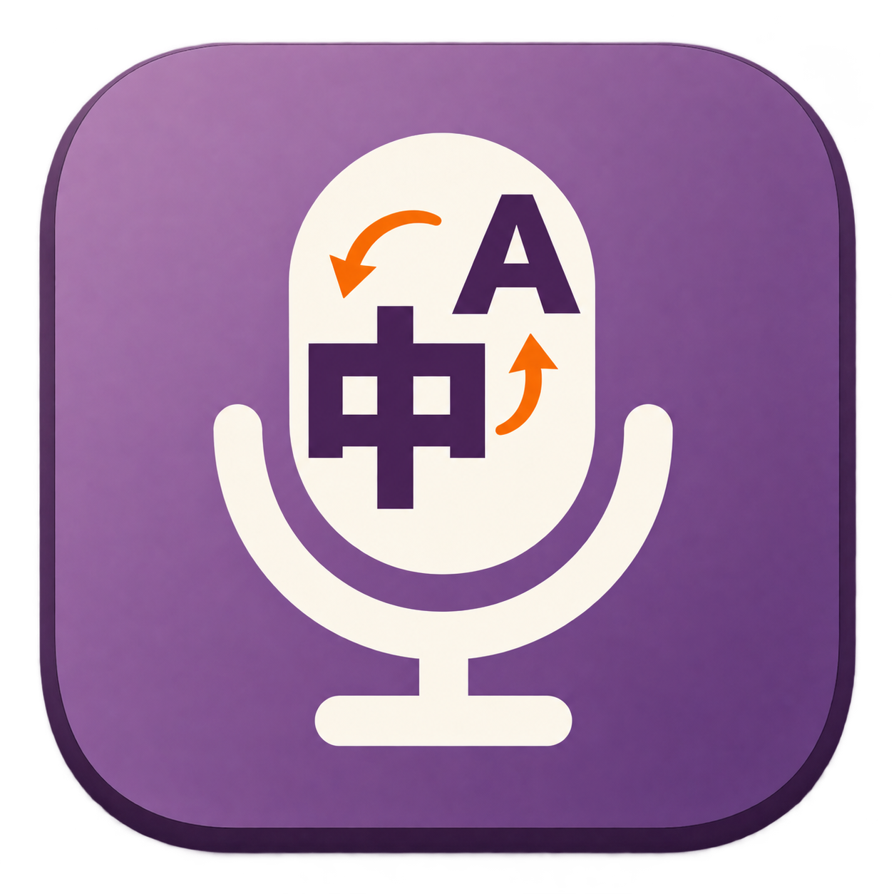

<p align="center">
  
</p>

<h1 align="center">逐語 Zhuyu</h1>

<p align="center">
  Mac 即時雙語逐字稿與翻譯<br>
  Real-time bilingual transcripts and translation for macOS
</p>

<p align="center">
  <a href="https://github.com/jason840709/zhuyu/releases/latest"><strong>下載 Mac 版 · Download for Mac</strong></a>
  · <a href="#english">English</a>
</p>

在 Mac 上看外語影片、聽課或開會時，逐語把聽到的話和翻譯並排顯示。你可以用麥克風收現場的聲音，也可以直接收 Mac 正在播放的音訊。

<p align="center">
  
</p>

## 逐語怎麼處理一段對話

- **兩欄各自固定一種語言。** 左邊選英文、右邊選繁體中文時，講中文的原話放右邊，英文譯文放左邊。對方換講英文時，原話自動放到左邊。繁體中文、英文和日文可以配對。
- **說話時先看到原話和暫譯。** 開啟本機暫譯後，講話途中就能看到灰色譯文。換句後，所選的雲端服務會參考前文產生正式譯文。暫譯可選 Apple 系統翻譯、本機模型或關閉。
- **專有名詞會跟著話題累積。** 逐語會從對話找出語境與術語，讓後續翻譯參考，並在支援的辨識模型上提供詞彙提示。「語意環境」可查看學到的詞與上下文校正。
- **逐句保留時間與譯文。** 原文與譯文一起保留時間，方便回看。歷史對話可搜尋、重新命名，並匯出 Markdown 或純文字。

## 下載與開始使用

需要 **Apple Silicon Mac（M 系列）與 macOS 26 以上**。逐語採用自備 API 金鑰，服務商依你的帳戶用量計費。

1. 從 [最新 Release](https://github.com/jason840709/zhuyu/releases/latest) 下載 arm64 的 ZIP，解壓縮後打開 `Zhuyu.app`（逐語）。
2. 在「設定」儲存金鑰，選擇辨識和翻譯服務。辨識可用 **OpenAI、Gemini**，翻譯可用 **OpenAI、Gemini、Claude**。
3. 兩欄各選一種語言，選「麥克風」或「電腦播放聲音」，按 **⌘R** 開始。

目前的下載版使用 ad-hoc 簽章，尚未經 Apple 公證。macOS 若在首次開啟時顯示未公證提示，可依 [Apple 的開啟說明](https://support.apple.com/zh-tw/102445) 處理。使用系統收音時，macOS 會另外詢問螢幕與系統音訊錄製權限。

[完整使用說明](docs/使用說明.md) · [模型與費率](docs/模型與費率.md)

## 本機暫譯

在「設定 → 本機暫譯」選一個引擎。

| 引擎 | 設定方式 |
| --- | --- |
| 本機模型（預設） | 連接本機的 OpenAI 相容伺服器，例如 Ollama 或 LM Studio。Ollama 可用 `ollama pull translategemma:4b` 下載預設模型。 |
| Apple 系統翻譯 | 在 macOS 下載對應的翻譯語言後使用。 |
| 關閉 | 顯示原文與定稿譯文，省去本機模型的運算。 |

本機暫譯是選用功能。預設 TranslateGemma 模型需另行下載，速度與品質尚未實測。[替換本機暫譯引擎](docs/替換本機暫譯引擎.md)

## 資料與隱私

音訊送往你選的語音辨識服務，翻譯及語境分析所需的文字送往你選的翻譯服務。本機暫譯只連這台 Mac 上的伺服器或使用系統翻譯。App 不保存錄音。

歷史、設定與金鑰存放在 `~/Library/Application Support/app.zhuyu.mac/`，其中 `Private/` 內的金鑰以明文儲存。開啟無痕模式可停用逐字稿與詞彙紀錄的本機保存。

## 從原始碼建置

需要包含 macOS 26 或更新 SDK 的 Xcode 或 Command Line Tools。

```bash
bash verify.sh    # 離線核心測試
bash build.sh     # 產生 build/逐語.app
```

原始碼以 [MIT 授權](LICENSE) 發布。API、本機模型與 Apple 系統翻譯依各自條款提供。下載版不附模型權重。

## English

**Zhuyu** is a macOS app for following bilingual conversations, lectures, meetings and videos. Set one language per column. When the speaker switches languages, the transcript moves to the matching column and the translation appears alongside it. Choose any pair of Traditional Chinese, English and Japanese.

- Capture your microphone or the audio playing on your Mac.
- Read on-device draft translations as someone speaks, then get a cloud translation after each utterance. Use Apple Translation, an OpenAI-compatible server on your Mac or turn drafts off.
- Carry the conversation topic and technical terms forward into later translations and use vocabulary hints with supported speech models.
- Search past conversations and export timestamps, transcripts and translations as Markdown or plain text.

[Download for Mac](https://github.com/jason840709/zhuyu/releases/latest) · [Usage guide (Traditional Chinese)](docs/使用說明.md)

**Requirements** — Apple Silicon, macOS 26+, and your own API keys. Use OpenAI or Gemini for transcription and OpenAI, Gemini or Claude for translation. The interface is in Traditional Chinese. The download is ad-hoc signed and has not been notarized. [Apple’s first-launch instructions](https://support.apple.com/en-us/102445)
