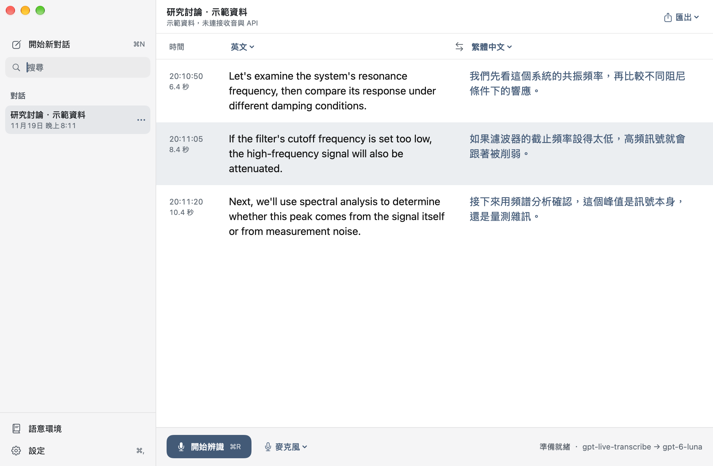

<p align="center">
  
</p>

<h1 align="center">逐語 Zhuyu</h1>

<p align="center">
  Mac 即時雙語逐字稿與翻譯<br>
  Real-time bilingual transcription and translation for macOS
</p>

<p align="center">
  <a href="https://github.com/jason840709/zhuyu/releases/latest"><strong>下載 Mac 版 · Download for Mac</strong></a>
  · <a href="#english">English</a>
</p>

在 Mac 上看外語影片、聽課或開會時，逐語會把聽到的話和翻譯並排顯示。收音可以用麥克風，也可以直接收 Mac 正在播放的聲音。

<p align="center">
  
</p>

## 主要功能

- **固定雙語雙欄**  
  左邊選英文、右邊選繁體中文時，講中文原話在右、英文譯文在左。對方換講英文，原話就會自動放到左邊。支援繁體中文、英文和日文任意兩兩配對。
- **即時暫譯與正式譯文**  
  開啟本機暫譯後，講話途中會先看到灰色暫譯。說完一句，再由你選的雲端服務參考同一對話前面最多三句，翻出正式譯文。暫譯可用本機模型、Apple 系統翻譯，或直接關閉。
- **自動整理語境與術語**  
  逐語會從對話整理語境與專有名詞供後續翻譯參考，在支援的語音辨識模型上也會提供詞彙提示。學到的詞彙和上下文校正，都可以在「語意環境」查看。
- **歷史紀錄與匯出**  
  每句原文和譯文都會記錄時間，方便事後回看。歷史對話支援搜尋、重新命名，也能匯出成 Markdown 或純文字。

## 下載與開始使用

需要 **Apple Silicon Mac（M 系列）與 macOS 26 以上**，並自備 API 金鑰，費用依各服務商的實際用量計算。

1. 到 [最新 Release](https://github.com/jason840709/zhuyu/releases/latest) 下載 arm64 的 ZIP，解壓縮後打開 `Zhuyu.app`（逐語）。
2. 在「設定」儲存金鑰，並選擇辨識與翻譯服務。語音辨識可用 OpenAI、Gemini。翻譯可用 OpenAI、Gemini、Claude。
3. 兩欄各選一種語言，挑「麥克風」或「電腦播放聲音」，按 `⌘R` 開始。

目前的下載版採 ad-hoc 簽章，尚未經過 Apple 公證。首次開啟若遇到 macOS 未公證提示，可參考 [Apple 的開啟說明](https://support.apple.com/zh-tw/102445)。使用系統收音時，macOS 會另行詢問「螢幕與系統音訊錄製」權限。

[完整使用說明](docs/使用說明.md) · [模型與費率](docs/模型與費率.md)

## 本機暫譯

在「設定 → 本機暫譯」選擇引擎。

| 引擎 | 設定方式 |
| --- | --- |
| 本機模型（預設） | 連接本機的 OpenAI 相容伺服器，例如 Ollama 或 LM Studio。用 Ollama 可執行 `ollama pull translategemma:4b` 下載預設模型。 |
| Apple 系統翻譯 | 在 macOS 下載對應的翻譯語言即可使用。 |
| 關閉 | 只顯示原文與正式譯文，不跑本機模型。 |

本機暫譯是選用功能。預設的 TranslateGemma 模型需另外下載，目前還沒實測速度與品質。詳見 [替換本機暫譯引擎](docs/替換本機暫譯引擎.md)。

## 資料與隱私

音訊送往你選的語音辨識服務，文字送往你選的翻譯服務做翻譯和語境整理。本機暫譯只連這台 Mac 上的伺服器，或使用系統翻譯。App 不保存錄音。

歷史紀錄、設定與金鑰存放在 `~/Library/Application Support/app.zhuyu.mac/`，其中 `Private/` 內的金鑰為明文儲存。開啟無痕模式後，就不會在本機保存逐字稿與詞彙紀錄。

## 從原始碼建置

需要包含 macOS 26 或更新 SDK 的 Xcode 或 Command Line Tools。

```bash
bash verify.sh    # 離線核心測試
bash build.sh     # 產生 build/逐語.app
```

原始碼以 [MIT 授權](LICENSE) 釋出。API、本機模型與 Apple 系統翻譯依各自條款提供。下載版不含模型權重。

## English

**Zhuyu** is a macOS app for following bilingual conversations, lectures, meetings, and videos. Pick one language for each column. When a speaker switches languages, each new line appears in its language’s column with the translation beside it. Works with any pair of Traditional Chinese, English, and Japanese.

- Captures audio from your microphone or what is playing on your Mac.
- Shows optional on-device draft translations while someone speaks, then replaces them with a cloud translation once the sentence finishes. Use Apple Translation, a local OpenAI-compatible server, or turn drafts off.
- Tracks the conversation topic and technical terms for later translations, and passes vocabulary hints to speech models that support them.
- Searches past conversations and exports timestamps, transcripts, and translations as Markdown or plain text.

[Download for Mac](https://github.com/jason840709/zhuyu/releases/latest) · [Usage guide (Traditional Chinese)](docs/使用說明.md)

Zhuyu requires Apple Silicon, macOS 26+, and your own API keys. Use OpenAI or Gemini for transcription and OpenAI, Gemini, or Claude for translation. The interface is in Traditional Chinese. The download is ad-hoc signed and not notarized by Apple. See [Apple’s first-launch instructions](https://support.apple.com/en-us/102445) if macOS shows a warning.
